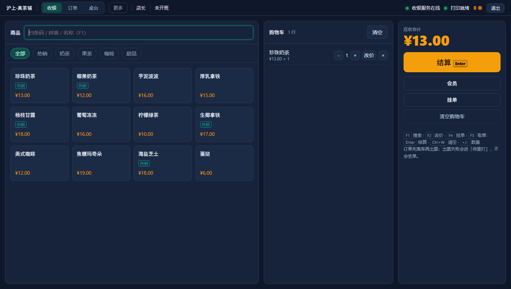
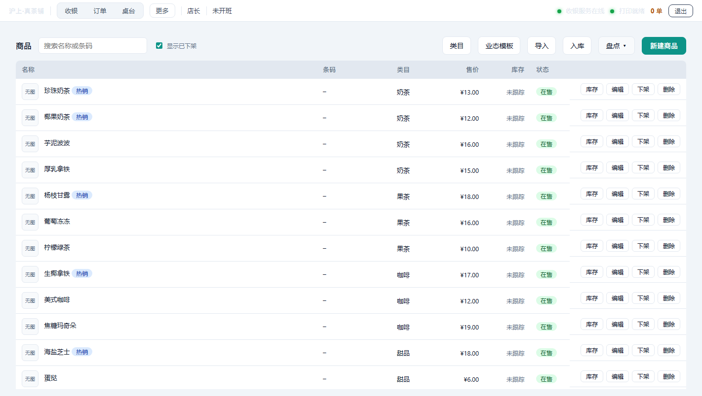

# Posd · Standalone POS

[](LICENSE)
[](go.mod)
English · [简体中文](README.md)

> **One executable. Double-click and start selling. Offline by design, data stays on your machine.**

Posd is a standalone point-of-sale system for small restaurants, tea shops and convenience stores:
checkout, held orders, tables, kitchen routing, membership and stored value, stock and stocktake,
purchasing, shifts, daily/monthly reports, receipts and price labels — all on one PC.

No cloud, no subscription, no remote activation. It keeps selling when the internet doesn't,
and your data never leaves the shop.



## Why

Small shops usually face three problems:

| Problem | What Posd does |
|---|---|
| Needs internet; no network, no sales | Local SQLite; full functionality offline |
| Annual fee; features get locked | Apache-2.0 open source; no paid switches on existing features |
| Painful installation | One executable (~12 MB), double-click to run |

## Features

| Area | Capability |
|---|---|
| Checkout | Cash / WeChat Pay / Alipay / member balance / points, split payments |
| Orders | Hold & resume, rounding, price override (audited), per-item refunds, void, refunds to original method |
| Dine-in | Open table, add items, merge, transfer, clear; table number on receipts and kitchen tickets |
| Kitchen | Multi-station routing by category; kitchen tickets without prices |
| Membership | Enrollment, top-up with bonus, balance, points rules, tier discounts, expiry reminders |
| Stock | Deduct on sale (bundle by component), restore on refund, stocktake, purchasing, low-stock alerts |
| Shifts | Open/close shift, handover report (refunds, voids, discounts, points, dine-in/takeaway, cross-shift refunds) |
| Reports | Daily, monthly, gross profit (estimated), 24-hour distribution, CSV export |
| Printing | ESC/POS receipts, kitchen tickets, barcode price labels, logo/QR on receipt, retry queue |
| Data | Automatic backups, audit log, role permissions, product images |



## Quick start

### Installer

Download from [Releases](../../releases) and run the installer. Default address `http://127.0.0.1:8080`,
default account `admin` / `1234` — **change the PIN right after the first login**.

Phones and tablets on the same LAN can open `http://<cashier-ip>:8080` as a second screen.

### Build from source

Requires Go 1.26+ and Node 20+:

```bash
git clone https://github.com/yixin-lot/posd.git && cd posd
npm --prefix web ci
npm --prefix web run build
node scripts/copy-embed.mjs
go build -trimpath -ldflags "-s -w" -o posd ./cmd/posd
./posd --addr 127.0.0.1:8080 --db ./data/pos.db
```

One-shot packaging on Windows (needs Inno Setup 6/7):

```powershell
pwsh -File scripts/pack/package.ps1 -Version 0.1.0
```

## Data and backups

- `pos.db` (SQLite WAL) sits next to the executable — **no network calls, no upload**;
- Automatic backups in `backups/` (7 kept by default);
- Uninstalling or deleting the program does **not** delete `pos.db` / `backups` / `images` — remove the folder yourself for a clean wipe.

## Stack

| Layer | Choice | Why |
|---|---|---|
| Backend | Go, single binary | No runtime dependencies; double-click to run |
| Database | SQLite (modernc, no CGO) | Simple cross-compilation; backup = copy a file |
| Frontend | Vue 3 + Vite (embedded at build time) | One codebase for cashier PC and phone |
| Printing | Built-in ESC/POS renderer | No drivers; USB or network printers |

## Docs

- [User guide](docs/user-guide.md)
- [Deployment](docs/deployment.md)

## Contributing

See [CONTRIBUTING.md](CONTRIBUTING.md). Opening a PR means you agree to [CLA.md](CLA.md).
Report security issues privately per [SECURITY.md](SECURITY.md).

## Status

**v0.1.0** — standalone edition is feature-complete and the Windows installer works.
Multi-store and cloud printing live in the commercial edition.
