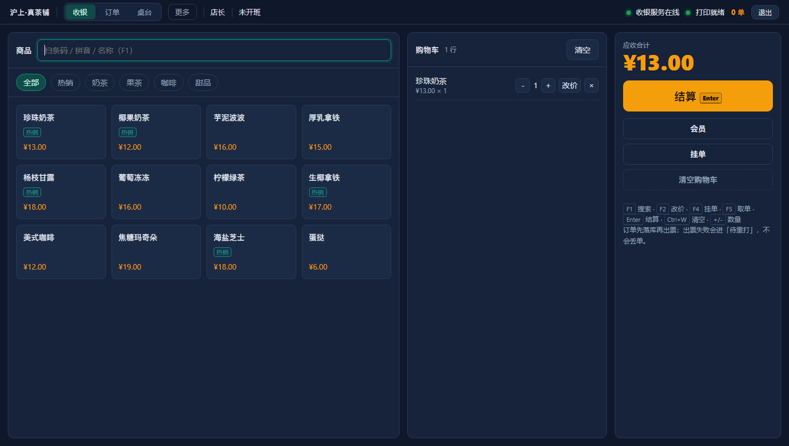
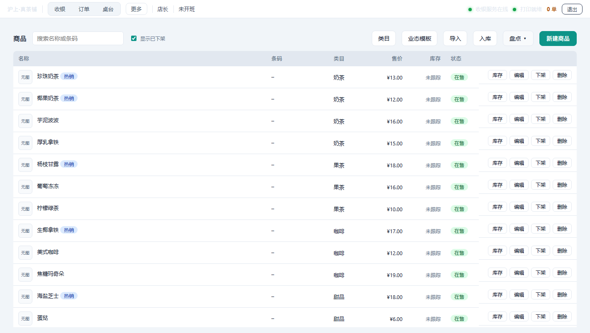

# Posd · 单机收银

[](LICENSE)
[](go.mod)
[English](README.en.md) · 简体中文

> **一个 exe，双击就能开张。离线运行，数据只存在你自己电脑上。**

Posd 是给小餐馆、奶茶店、便利店用的单机收银系统：收银、挂单、桌台、后厨分单、会员储值、
库存盘点、采购入库、班次交接、日结月结、小票与价签打印，全部在一台电脑上完成。

没有云端、没有订阅、没有远程激活。断网照样卖货，数据不出店门。



## 为什么做这个

小店的收银软件常见三类问题：

| 问题 | Posd 的做法 |
|---|---|
| 要联网，断网不能卖货 | 本地 SQLite，离线全功能 |
| 要年费，不交就锁功能 | Apache-2.0 开源，现有功能没有付费开关 |
| 要装机，环境折腾半天 | 单个 exe（约 12 MB），双击即用 |

## 功能

| 模块 | 能力 |
|---|---|
| 收银 | 现金 / 微信 / 支付宝 / 会员余额 / 积分抵扣，支持组合支付 |
| 订单 | 挂单取单、抹零、改价（审计）、按件退款、整单作废、退款原路 |
| 餐饮 | 桌台开台、加菜、并台、转台、清台，小票与后厨单带桌号 |
| 后厨 | 多档口分单（按类目路由到不同打印机），后厨单不印价格 |
| 会员 | 开卡、充值（含储值赠送）、余额、积分规则、等级折扣、到期提醒 |
| 库存 | 下单扣减（套餐按组件）、退款回补、盘点单、采购入库、低库存提醒 |
| 班次 | 开班结班、交接单（退款/作废/折扣/积分/堂食外带/跨班次退款） |
| 报表 | 日结、月结、毛利（估算）、24 小时时段分布、CSV 导出 |
| 打印 | ESC/POS 小票、后厨单、价签条码、小票 logo/二维码、失败重打队列 |
| 数据 | 自动备份、审计日志、权限分级、商品图片 |



## 快速开始

### 用安装包

从 [Releases](../../releases) 下载，双击安装。默认地址 `http://127.0.0.1:8080`，
默认账号 `admin` / `1234`（**首次登录后请立刻改 PIN**）。

同一局域网的手机/平板浏览器打开 `http://收银机IP:8080` 即可当副屏。

### 从源码构建

需要 Go 1.26+ 与 Node 20+：

```bash
git clone https://github.com/yixin-lot/posd.git && cd posd
npm --prefix web ci
npm --prefix web run build
node scripts/copy-embed.mjs
go build -trimpath -ldflags "-s -w" -o posd ./cmd/posd
./posd --addr 127.0.0.1:8080 --db ./data/pos.db
```

Windows 一键打包（需要 Inno Setup 6/7）：

```powershell
pwsh -File scripts/pack/package.ps1 -Version 0.1.0
```

## 数据与备份

- 数据在程序同目录的 `pos.db`（SQLite WAL），**不联网、不上传**；
- 自动备份到 `backups/`（默认保留 7 份）；
- 卸载或删除程序**不会**删 `pos.db` / `backups` / `images`——要彻底清理请手动删目录。

## 技术栈

| 层 | 选型 | 为什么 |
|---|---|---|
| 后端 | Go 单文件 | 无运行时依赖，双击即用 |
| 数据库 | SQLite（modernc，无 CGO） | 跨平台编译简单，备份就是拷文件 |
| 前端 | Vue 3 + Vite（构建期内嵌） | 一套代码适配收银机与手机 |
| 打印 | 内置 ESC/POS 渲染 | 不依赖驱动，USB / 网口均可 |

## 文档

- [使用手册](docs/user-guide.md)
- [部署指南](docs/deployment.md)

## 参与贡献

见 [CONTRIBUTING.md](CONTRIBUTING.md)。提交 PR 即视为同意 [CLA.md](CLA.md)。
安全漏洞请按 [SECURITY.md](SECURITY.md) 私密报告。

## 状态

**v0.1.0**：单机版功能完整，Windows 安装包可用；多店连锁、云打印等能力在商业版中提供。
