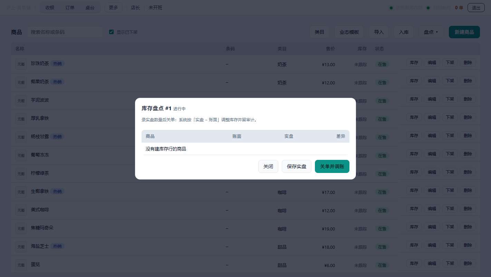

# 开源收银 POS · 店主使用手册

> 面向不开技术细节的店主：跟着本手册走一遍，就能完成第一笔生意。
> 版本对应：`posd 0.1.0`（单机版，离线可用，数据只存在你自己电脑上）。

---

## 1. 安装与启动

1. 拿到 **posd.zip**（单机版安装包）。
2. 解压到任意文件夹，例如 `D:\pos`。解压后里面有 `posd.exe` 和 `data` 文件夹。
3. **双击 `posd.exe`** 启动（会打开一个小窗口，不要关它，关闭即退出收银系统）。
4. 打开浏览器（Chrome / Edge 都行），在地址栏输入：`http://127.0.0.1:8080`，回车。

看到登录页就安装成功了。

> 数据都保存在安装目录的 `data` 文件夹里（`data/pos.db` 是全部账目）。
> 想换一台电脑，把整个 `data` 文件夹复制过去即可。

**关于打印机**（可选）：没有打印机也能用，小票会保存到 `data/print.bin` 方便以后对账。
接好打印机后，用带参数的启动方式：

```
posd.exe --printer "你的打印机名称"
```

---

## 2. 首次登录与改 PIN

1. 账号填 **admin**，PIN 填 **1234**，点「登录」。


2. 第一次登录会弹出一个三步向导，跟着走（都可以跳过）：
   - **第 1 步 选业态**：选一个和你店里最像的业态（茶饮 / 烘焙 / 快餐 / 超市等），
     会自动导入一套示例商品作为起点；
   - **第 2 步 店铺信息**：填店名、电话、小票脚注（之后可在「设置」里改）；
   - **第 3 步 员工安全**：提示你改掉默认 PIN。

3. **强烈建议正式使用前修改 PIN**：顶部导航点「员工」→ 在店长那一行点「改 PIN」，
   输入新 PIN（至少 4 位）保存。默认 1234 太容易被猜中。

> 小提示：登录失败 5 次，账号会锁定 5 分钟（提示剩余时间），这是防盗机制，
> 等一会儿或用正确的 PIN 重新登录即可。

---

## 3. 收银：完成第一单

1. 顶部导航点「收银」。
2. **加购商品**：
   - 鼠标点商品卡片，加入购物车；
   - 有扫码枪：直接扫条码，扫到即加购（搜索框会自动保持聚焦，连扫三件就进三行）。
     也可以用键盘输入商品名称或条码，按 **Enter** 快速匹配。
3. 购物车确认无误后，点「**结算**」（或按 Enter）。
4. 选支付方式：
   - **现金**：输入顾客给的实收金额，自动算找零；
   - **微信 / 支付宝**：点对应按钮即可（记账式，只记录方式与金额）。
5. 点「**确认收款**」，小票打印完成，界面提示「出票完成」。


**快捷键**：`F1` 聚焦搜索框 · `Enter` 结算 · `Esc` 关闭弹窗。

> 订单会**先落库再出票**：即使打印失败，订单也不会丢，
> 会出现在「订单」页的「待重打」里，可以补打。

---

## 4. 退款与作废

顶部导航点「订单」，每一笔订单后面有四个按钮：**明细 / 重打 / 退款 / 作废**。

- **退款**：支持整单退款和按件退款（比如只退其中一件）。退款后订单显示「已退款」标记。
- **作废**：整单作废（计错单时用），作废单不计入销售和报表。
- **重打**：打印失败或小票丢了，可以随时补打。


> 退款、打折、改价、作废这些操作默认只有店长能做。
> 想放开给收银员：去「设置」页勾选对应权限。

---

## 5. 交接班

顶部导航点「班次」：

1. 上班时点「**开班**」，填**期初现金**（收银机里已有的零钱）和**收银员**姓名；
2. 下班前回来点「**交班**」，系统按本班订单核对收银金额，用于对账。

---

## 6. 看报表

顶部导航点「报表」，选「今天 / 昨天 / 近 7 天」：

- **净销售**、订单数、客单价、现金净额；
- **收款构成**：现金 / 微信 / 支付宝 各收了多少、占比多少；
- 商品销量 Top 10。

---

## 7. 设置小票与权限

顶部导航点「设置」：

- **小票抬头**：店名、电话、脚注，改完保存，下一张小票立即生效；
- **收银员权限**：默认关闭，可勾选「允许收银员退款 / 整单打折 / 单品改价 / 作废订单」。


---

## 8. 备份与恢复

**自动备份**：系统会在启动时和每天自动给数据库打一份快照，存放在
`data/backups` 文件夹（自动保留最近若干份，旧的自动清理）。备份文件就是完整的账目文件。

**手动恢复**（电脑出问题、误操作时用）：

1. 关闭 posd 程序（退出登录后关闭窗口）；
2. 打开 `data\backups`，把**最新**那个 `.db` 文件复制出来；
3. 用这个文件**覆盖** `data\pos.db`；
4. 重新启动 posd.exe，账目就回到备份时的状态。

> `data/pos.db` 是唯一的账本，丢了就是全部账目丢失。
> 建议定期把 `data` 文件夹整个复制到 U 盘或网盘。

---

## 9. 支付方式（现金 / 微信 / 支付宝）

结算时三选一，可以混用：

- **现金**：输入顾客给的实收金额，系统自动算找零；
- **微信 / 支付宝**：点按钮收款即可。**扫码是记账式**——只记录支付方式和金额，
  不核对平台到账，收银员按「应收」金额收款、给顾客出示付款码即可。

小票上会打印每一笔支付方式，方便对账。

---

## 10. 挂单与取单

顾客挑好商品又要加别的时，不用清空购物车：

1. 收银台点「**挂单**」，这单会留在页面顶部的挂单条上；
2. 继续收下一单；忙完后再点那条挂单，购物车恢复，继续结算。

> 挂单不计入销售和报表，也不出小票；取单收款后才会正式入账。

---

## 11. 抹零（抹分 / 抹角）

店长可在「设置」页选「**抹零方式**」：

- **不抹零**：按实收金额收款；
- **抹分**：把分位抹掉（如 13.87 收 13.80）；
- **抹角**：把角位抹掉（如 13.87 收 13.00）。

抹掉的部分会单独记在订单上，报表照常核算，不会丢账。

---

## 12. 常见问题

| 问题 | 怎么办 |
|---|---|
| 登录提示失败次数过多（锁定） | 等 5 分钟再试；这是防猜 PIN 的安全机制 |
| 小票没打出来 | 去「订单」页找「待重打」，点「重打」；也可以检查打印机是否开、连接是否正确 |
| 想换店名 / 电话 | 「设置」页修改，保存后下一张小票生效 |
| 想加店员 | 「员工」页新建，店员默认只能收银 |
| 换电脑搬家 | 整个 `data` 文件夹复制到新电脑的安装目录，重启即可 |
| 系统打不开（端口占用） | 确认没有重复启动 posd.exe；重启电脑后再次双击 posd.exe |

---

## 13. 桌台：开台、结账与清台

适合堂食点单：先给客人占一张桌，点单后不急着收钱，吃完再结账。

- **开台**：顶部点「桌台」，空闲桌点「开台」，填人数并选商品，确认后桌台变为占用，点单会变成一张「挂单」。
- **结账**：占用桌点「结账」，会弹出收款窗口，金额就是这桌挂单的应收（不含桌台自己的加价），收款成功后桌台自动清空、变回空闲。
- **清台**：客人直接走了、没消费完，占用桌点「清台」即可把桌位释放；挂单不会删除，仍可在「订单」页找到并收款。
- **新建桌台**：只有店长能新建，点右上角「新建桌台」，输入桌名（如 A1、大厅 2 号）即可。
- 桌台本身不记钱，账都记在挂单上，所以报表、退款与普通订单完全一致。

---

## 14. 后厨联打

想下单时同时给厨房打一张制作单，就在「设置 → 后厨联打」里配置：

- **后厨打印机名**：填电脑上已安装的打印机名称，例如「厨房打印机」或「EPSON 热敏」。怎么看打印机名：Windows 打开「设置 → 蓝牙和其他设备 → 打印机和扫描仪」，列表里显示的名字就是。填错或填了不存在的名字，后厨单打不出来，但收银小票不受影响。
- **出后厨单的类目**：填要出单的类目，多个用逗号分隔，例如 `奶茶,小吃`；留空表示全部类目都出。
- **不想要后厨单**：把「后厨打印机名」留空即可，下单时只打收银小票。
- 保存后立即生效，下一单开始按新配置出单。

---


---

## 6. 桌台（堂食）

### 开台
1. 顶部点「桌台」，看到网格卡片；
2. 空闲桌点「开台」→ 填人数、选菜品数量 → 「确认开台」；
3. 桌台变「占用」，同时**生成一张挂单**（订单页可见）。

### 加菜
占用中的桌台点「加菜」→ 选数量 → 确认。应收会自动重算。

### 并台（两桌合并）
1. A 桌点「并台」→ 选择要并入的 B 桌（只列占用中的桌台）；
2. A 桌的菜全部并入 B 桌，A 桌释放；
3. A 桌原单标记为「已作废（并台）」，不产生退款（挂单本来没收钱）。

### 转台（换桌）
A 桌点「转台」→ 选择一张空桌 → 订单整体挪过去，桌号跟着变（小票/后厨单都会用新桌号）。

### 结账 / 清台
- 「结账」= 收款 + 释放桌台；
- 「清台」= 只释放桌台，挂单仍留在订单页（客人走了但账还没收的情况）。

---

### 套餐（组合商品）
商品页新建时把「类型」选成**套餐**，再添加组件（如 珍珠奶茶×1 + 蛋挞×2），套餐有自己的售价。

- 结账按**套餐价**收，不按组件累加；
- 后厨按**组件**分档口：奶茶去水吧、蛋挞去后厨，数量自动乘套餐份数；
- 订单明细保存组件快照，商品改价/下架不影响历史单；
- 退套餐按整份退，金额等于套餐价 × 份数；
- **可选项**：组件填「选项组」1、2…，同组互为替代（如奶茶/果茶）。收银时点套餐会弹窗让顾客选，组内取一个；不选则默认第一个。

## 7. 后厨联打（多档口）

设置页 → 后厨档口，一个档口 = 一台打印机 + 一组类目：

| 档口 | 打印机 | 类目 |
|---|---|---|
| 水吧 | POS-58 | 奶茶,果茶 |
| 热菜 | POS-80 | 主食,小炒 |

下单后：水吧只收到奶茶果茶，热菜只收到主食小炒。类目留空表示该档口收全部菜品。

后厨单**不打印价格**，只打印：档口名 / 桌号 / 单号 / 时间 / 品名×数量。

---

## 8. 会员

### 开卡与充值
收银台「会员」按钮 → 输入手机号（11 位）→ 开卡 → 充值。

### 储值赠送
设置页可配「满 X 元送 Y 元」，例如 `500:50,1000:150`：充 500 送 50，充 1000 送 150（取最高档，不叠加）。

- 赠送金额与本金**分两条流水**记录（本金 topup、赠金 bonus），便于统计营销成本；
- 收银台充值成功后提示「另赠 ¥50.00」；
- 留空表示不赠送。

### 结算用余额
点「会员」选人 → 结账时支付方式出现「会员余额」；有积分且够抵扣时出现「积分抵扣」（默认 100 积分 = 1 元）。

### 等级
按累计消费自动升级（设置页可改规则，默认）：

| 累计消费 | 等级 | 折扣 | 积分倍率 |
|---|---|---|---|
| 0 | 普通会员 | 无 | 1 倍 |
| 1000 元 | 银卡会员 | 2% | 2 倍 |
| 5000 元 | 金卡会员 | 5% | 3 倍 |

会员价会在结账时自动生效，**服务端计算，前端改不了**。

### 积分过期
- 设置页可设「积分有效期（月）」，0 = 永不过期；
- 快过期时：小票底部提醒 + 会员中心顶部横幅；
- 真过期：自动清零并记一条「积分过期」流水。

### 停用 / 删除
- **停用**：会员不能再用余额/积分消费，历史保留；
- **删除**：有流水的会员删不掉，只能停用。

---

## 9. 交接班

- 开班：填备用金 → 开始营业；
- 结班：填钱箱实收 → 系统算「应有多少」并给出差异；
- 交接单打印：销售/退款/作废/会员折扣/积分发放核销/堂食外带。

**差异不为 0 时先别关单**：检查是否有未录入的退款或作废。

---

## 9.5 库存（MVP）

- **只有建了库存行的商品才跟踪**（小店常只关心少数原料/成品）；
- 建库存：库存接口 `PUT /pos/v1/stock/{productId}`，设数量与告警阈值；
- 下单自动扣减，**套餐按组件扣**；退款/作废自动回补；
- 默认允许卖成负库存（先卖后补货），要拦截就把设置 `stock_block_when_short` 设为 `true`；
- 补货/报损：`POST /pos/v1/stock/{productId}/adjust`，写审计；
- 需要补货的清单：`GET /pos/v1/stock/alerts`。

### 价签 / 条码打印



商品页「价签」：勾选商品 → 填每款份数 → 打印。有 barcode 的商品会一并打出条码（CODE39）。

> 走 ESC/POS 标准指令，**常规 USB/网口小票机默认支持**；标签纸按 32 列排版。

### 商品图片

商品编辑弹窗里选图（png/jpeg，≤3MB、最长边 1200px），保存后列表显示缩略图，收银台卡片也会带上。

> 图片存在数据目录 `images/` 下；备份时连同目录一起备份。

### 小票模板（logo / 二维码）

店铺设置里可上传 logo（小票顶部打印）、填写二维码内容（如加群链接）。
两项都留空则小票保持原样；logo 会转成黑白光栅，宽度压到 256 点。

> 二维码用 ESC/POS 原生 `GS ( k` 指令，常规 USB/网口小票机默认支持，不依赖电脑端生成图片。

### 小票页脚

店铺设置里的「小票页脚」会印在每张销售小票最后（可留空，支持用换行分多行）。
适合放"谢谢惠顾 / 电话 138xxxx / 扫码加群"这类固定文案。

### 盘点（每月一次）

1. 商品页点「盘点」→ 自动生成一张盘点单（把当前账面数量拍快照）；
2. 逐个录实盘数量，差异列会立刻显示（红色为盘亏）；
3. 点「关单并调账」→ 库存按实盘改写，每条差异写审计（谁、何时、差多少）。

### 采购入库

店铺设置 → 进货接口 / 或调 `POST /pos/v1/purchases`（店长）：

- 记供应商、数量、进价（分/件）；
- 入库同时把数量加到库存；**没建库存行的商品会自动建行**；
- 每次入库写审计，单据可查（`GET /pos/v1/purchases`）。

> 已关单的盘点单不能再改；未录入实盘的商品保持原样，不会被清零。

## 10. 报表

| 报表 | 在哪 | 导出 |
|---|---|---|
| 日结 | 报表页 | 导出 CSV |
| 月结 | 报表页切「月结」 | 导出本月 CSV |

指标口径：

- **净销售 = 销售 − 退款**（作废不计销售）；
- **会员消费** = 会员余额/积分支付的金额；
- **会员折扣** = 等级让利，单独列示，不冲减净销售；
- **客单价 = 净销售 ÷ 订单数**。

---

## 11. 数据与安全

- 所有数据在 `pos.db`，**不上传任何服务器**；
- 每天自动备份，保留 7 份；
- 换机：复制整个 `pos.db` 到新机器即可；
- 建议：定期把备份复制到 U 盘或网盘。

---

## 12. 常见问题

| 问题 | 处理 |
|---|---|
| 打不开页面 | 端口被占，换端口启动：`posd.exe --addr 127.0.0.1:8081` |
| 不出纸 | 检查打印机名是否与 Windows 队列名一致 |
| 后厨不出单 | 检查档口类目与商品类目是否一致 |
| 提示「会员已停用」 | 会员中心里点「启用会员」 |
| 积分没加 | 只有会员余额支付才积分；现金支付不积分 |
| 忘记 PIN | 用另一个店长账号重置；都不行则需恢复备份 |
## 13. 桌台：并台与转台

两桌客人要坐一起、或想换到更大/更空的桌子时，不用先结账再重新开台：

- **并台**：把一桌的挂单合并到另一桌。占用桌点「并台」，在弹窗里选目标桌（另一张**占用中**的桌），确认后原桌变回空闲，商品与应收合并到目标桌，并提示「已并入 X 桌，共 N 件商品，应收 ¥xx.xx」。
  - 弹窗里只有占用中的桌可选；没有其他占用桌时，会提示「没有其他占用中的桌台可并入（先开台再并台）」。
- **转台**：把一桌整个换到另一张空桌（比如客人换座位）。占用桌点「转台」，在弹窗里选目标桌（**空闲**的桌），确认后原桌变回空闲，目标桌占用并沿用原来的开台时间与人数。
  - 弹窗里只有空闲的桌可选；没有空闲桌时，会提示「没有空闲桌台可转入（先清台或结账腾出空桌）」。
- 并台/转台都不动商品价格与挂单金额，也不会重复收款；目标桌应收 = 两张桌挂单之和。

---

## 14. 积分到期提醒

会员积分设置了有效期时，收银页顶部的「会员」页会出现积分到期提醒横幅：

- 横幅显示「积分到期提醒（N 位会员 7 天内到期）」，点「展开」可以查看到期会员列表（会员名 / 手机号 / 积分数 / 到期日）。
- 列表每行有「打印提醒」按钮（当前为置灰不可点）：结账时若消费人是该会员，系统会在小票上自动打印积分到期提醒，无需手动操作。
- 不想在本次登录期间看到提醒，点横幅右侧的「×」即可关闭；关闭后本会话（浏览器窗口）内不再显示，下次重新打开页面会恢复提醒。
- 没有 7 天内到期的会员时，横幅不显示。

---


---

## 15. 挂单超时怎么办

挂单属于**临时行为，限时 30 分钟**：超过 30 分钟未成功交易，系统会**自动取消**这笔挂单。

- 订单页的挂单会显示「已挂 X 分钟」的时长；接近 30 分钟的挂单整行会标出黄色竖线，页面顶部出现提示：

  > 有 N 张挂单超过 30 分钟，未结算将自动取消。

- 挂单超过 30 分钟未结算（未收款），系统自动把状态改为**已取消**，订单页显示「已取消」标记与原因；取消的挂单不会产生任何费用或退款流水（钱从未进钱箱），也不会影响班次与报表统计。
- 想要这笔单，在 30 分钟内点「收款」结算即可；超过 30 分钟被取消后无法恢复，需要重新下单。

## 16. 手机怎么用（移动端）

浏览器宽度 430px 以下（手机、小平板）自动切换移动布局，无需横屏：

- 顶部页签收进右上角「**更多**」下拉，收银/订单/桌台等页面都能进；「退出」保留在顶栏右侧。
- 商品按 **2 列** 展示，点商品加入购物车。
- 购物车变成**底部抽屉**：点底部「购物车」按钮上滑查看已选商品（数量加减 / 改价 / 删除）。
- 底部结算条固定：左侧金额，右侧「结算」与「购物车」按钮，方便单手操作。
- 结算弹窗从底部弹出、按钮通栏全宽，金额放大显示。

---

*手册版本：2026-11-04（桌台并台/转台、后厨多档口、会员等级与积分、交接班、积分到期提醒、手机端布局、挂单 30 分钟限时自动取消）。有问题请联系技术支持。*
